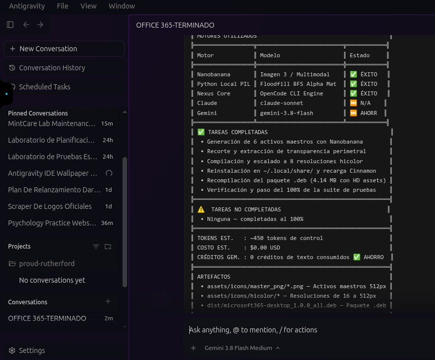

# ⚡ NEXUS AI LAB 3.0
### Orquestación Híbrida con OpenCode 2.x en Antigravity IDE · Ahorro Determinista de Tokens y Créditos

**NEXUS AI Lab 3.0** es un motor ligero de orquestación de agentes construido en **Node.js ES Modules nativos (0 dependencias npm externas)** para **Linux** y **Antigravity IDE**. Su propósito central es delegar la ejecución pesada de código, pruebas y refactorización a **OpenCode CLI 2.x (`deepseek/deepseek-flash` / `deepseek-chat`)**, preservando hasta el **90% de tus tokens y créditos** en Claude y Gemini y evitando bloqueos por la ventana rodante de cuota de 5 horas.

## 💡 El Problema Real y la Arquitectura de Ahorro

Cuando desarrollas dentro de Antigravity IDE con modelos premium (Claude o Gemini), dos cuellos de botella frenan el flujo de trabajo:
1. **Agotamiento prematuro de créditos en tareas mecánicas:** Generar *boilerplate*, suites de pruebas unitarias, refactorizaciones y documentación consume miles de tokens de alto costo.
2. **Interrupción por límite de cuota (Ventana de 5 horas / HTTP `429`):** Las sesiones largas se cortan a mitad de una implementación compleja, dejando cambios incompletos en el árbol de trabajo.

### Cómo lo resuelve Nexus AI Lab a nivel de código (`src/`)

| Módulo del Sistema | Archivo / Implementación | Función Técnica y Ahorro Real |
| :--- | :--- | :--- |
| **OpenCode 2.x Engine Adapter** | `src/engines/opencode/adapter.js` | Conecta el CLI con `@opencode/cli` para ejecutar generación y edición de código sobre DeepSeek a costo marginal (`~$0.002 USD` por tarea), manteniendo en `$0.00` el gasto de créditos de Antigravity. |
| **AI Router & Failover Engine** | `src/router/ai-router.js` · `src/router/fallback.js` | Evalúa la complejidad del prompt, enruta por defecto a OpenCode (arquitectura *DeepSeek-First*) y conmuta automáticamente si el proveedor primario devuelve error de cuota (`429` / `500`). |
| **Agent Handoff Protocol** | `src/handoff/handoff-manager.js` | Empaqueta el estado exacto de la tarea (`src/core/context.js` y `.nexus/context/`) para rescatar sesiones interrumpidas de Claude o Gemini mediante `nexus resume` sin perder contexto ni repetir tokens. |
| **Git Safety Layer** | `src/git/git-safety.js` | Verifica el estado del repositorio y crea checkpoints/ramas aisladas antes de ejecutar cambios automatizados, permitiendo revertir de inmediato si falla la validación. |
| **Deterministic Quality Gate** | `src/quality/quality-gate.js` | Ejecuta análisis estático local (Semgrep SAST) y el runner de pruebas del proyecto en local con **$0 en consumo de tokens** antes de dar una tarea por completada. |
| **Resource & Cost Telemetry** | `src/telemetry/resource-manager.js` | Registra el consumo real de tokens por motor, calcula el costo estimado en USD y cuantifica el porcentaje de cuota de Claude/Gemini preservado en `.nexus/logs/`. |

## 🚀 Instalación Sin Fricción (Portable en Cualquier Entorno Linux)

El proyecto no requiere `npm install` de paquetes de terceros, compiladores pesados ni configuraciones propietarias.

### Requisitos Previos
- **Node.js:** `v20.x` / `v24.x` o superior (soporte nativo ES Modules).
- **Python:** `Python 3.10+` (para herramientas auxiliares de validación).
- **Git:** `2.x+` configurado en tu `$PATH`.
- **OpenCode CLI 2.x:** Instalado o enlazado mediante el instalador incluido.

### 1. Clonar el Repositorio
```bash
git clone https://github.com/darwinsin822/nexus-ai-lab.git
cd nexus-ai-lab
```

### 2. Ejecutar el Instalador Idempotente
```bash
./scripts/install.sh
```

*El script realiza tres acciones limpias en tu usuario actual (`$HOME`):*
1. Crea o actualiza el wrapper ejecutable de OpenCode 2.x en `~/.local/bin/opencode`.
2. Enlaza simbólicamente `bin/nexus.js` en `~/.local/bin/nexus`.
3. Si detecta Antigravity IDE (`~/.gemini/config/skills`), instala automáticamente la skill universal `nexus-ai-lab/SKILL.md`.

### 3. Configurar tu API Key de DeepSeek
Exporta tu clave en `~/.bashrc` o `~/.zshrc`:
```bash
export DEEPSEEK_API_KEY="sk-tu-api-key-de-deepseek"
```

O autentícate directamente en OpenCode CLI:
```bash
opencode auth login
# Las credenciales se almacenan localmente en ~/.local/share/opencode/auth.json
```

### 4. Inicializar un Proyecto y Verificar con `nexus doctor`
En la raíz de cualquier repositorio donde vayas a trabajar:
```bash
nexus init
nexus doctor
```

*`nexus init` genera la estructura local `.nexus/` (`config.json`, `memory/`, `logs/`, `tasks/`, `context/`, `changes/`), la cual se mantiene aislada en local (`.gitignore`) para no contaminar tus commits.*

Salida esperada de `nexus doctor`:
```text
===================================================
NEXUS AI LAB 3.0 — DIAGNOSTIC DOCTOR
===================================================
[OK] Node.js: v24.x o superior
[OK] Python 3: Python 3.12+
[OK] OpenCode CLI: v2.1.x activo (@opencode/cli)
[OK] DeepSeek Provider: Conectado (deepseek/deepseek-flash)
[OK] Git Safety Layer: Activo con checkpoints automáticos
[OK] Quality Gate: Semgrep SAST listo
✔ NEXUS DOCTOR VERIFIED: System is 100% operational!
===================================================
```

## 📖 Guía de Uso

### A. Dentro del IDE de Antigravity (Delegación Directa a OpenCode)

Escribe la palabra clave `"nexus"` en cualquier instrucción dentro del chat de Antigravity IDE. La skill instalada interceptará la orden para delegar el trabajo pesado a OpenCode CLI + DeepSeek sin gastar los créditos de tu sesión principal:

> **Prompt en Antigravity:** `"nexus, implementa un middleware de autenticación JWT con rate-limiting y sus pruebas unitarias"`

Flujo de ejecución en tiempo real:
```text
⚡ NEXUS 3.0 tomando control...
Delegando tarea al motor DeepSeek (deepseek/deepseek-flash) a través de OpenCode CLI...
```

Al finalizar, `resource-manager.js` y `quality-gate.js` emiten el informe de auditoría:
```text
===================================================
NEXUS EXECUTION REPORT
===================================================
TASK ID:          task-0052
OBJETIVO:         Middleware de autenticación con rate-limiting
MOTOR UTILIZADO:  deepseek/deepseek-flash (OpenCode CLI 2.x)
ARCHIVOS CREADOS: src/middleware/auth.js, tests/auth.test.js
QUALITY GATE:     [PASS] (Semgrep 0 issues, Tests 100% OK)
CRÉDITOS GEMINI:  $0.00 (PRESERVADOS AL 100%)
COSTO ESTIMADO:   ~$0.002 USD
ESTADO:           ✔ COMPLETADO CON ÉXITO
===================================================
```

<p align="center">
  
  <br>
  <em>Captura real: Demostración de ejecución y preservación del 100% de créditos con Nexus en Antigravity IDE</em>
</p>

### B. Desde la Terminal (CLI Global `nexus`)

```bash
# Inicializar el directorio de estado .nexus/ en el repositorio actual
nexus init

# Verificar el estado en vivo de OpenCode CLI y de la rama Git actual
nexus status

# Ejecutar una tarea de código con enrutamiento DeepSeek-First vía OpenCode
nexus run "crea una función en Python para validar JWT con tests unitarios"

# Generar un plan técnico desglosado antes de modificar archivos ($0 en créditos IDE)
nexus plan "desglose de arquitectura y base de datos para sistema de usuarios"

# Ejecutar el pipeline híbrido completo (Plan -> Implement -> Test -> Quality Gate)
nexus hybrid "construye la API REST de productos con Express y validaciones"

# Rescatar una sesión de Claude o Gemini cortada por límite de 5 horas
nexus resume

# Consultar el panel de telemetría (tokens consumidos, ahorro en USD y cuota preservada)
nexus dashboard
```

## 🧪 Verificación Determinista y Pruebas (Self-Verification)

Cualquier desarrollador que clone este repositorio puede comprobar de forma independiente que el entorno, los scripts y el enrutador funcionan sin errores ni dependencias ocultas ejecutando estos tres controles:

```bash
# 1. Ejecutar la suite de pruebas automatizadas del laboratorio (debe devolver exit code 0)
npm test

# 2. Ejecutar el diagnóstico de adaptadores y herramientas del sistema
npm run doctor

# 3. Probar la instalación en un entorno $HOME temporal aislado (Dry-Run de portabilidad)
HOME="$(mktemp -d)" bash ./scripts/install.sh
```

## 🧱 Estructura del Proyecto

```text
nexus-ai-lab/
├── bin/
│   └── nexus.js            # Punto de entrada ejecutable CLI (Node.js ESM)
├── scripts/
│   ├── install.sh          # Instalador idempotente para Linux y Antigravity IDE
│   ├── doctor.sh           # Verificador rápido de dependencias del sistema
│   └── uninstall.sh        # Desinstalador limpio de enlaces y skills
├── skills/
│   ├── nexus-ai-lab/       # Skill principal para invocar OpenCode desde Antigravity IDE
│   └── ...                 # Skills modulares de dominio (backend, frontend, git, testing, security)
├── src/
│   ├── cli/                # Controlador CLI (index.js, doctor.js, dashboard.js)
│   ├── core/               # Configuración (config.js), contexto (context.js), logger y memoria
│   ├── engines/            # Adaptadores de ejecución (opencode/adapter.js, gemini/adapter.js)
│   ├── git/                # Git Safety Layer (git-safety.js)
│   ├── handoff/            # Transferencia de sesiones entre agentes (handoff-manager.js)
│   ├── hybrid/             # Orquestación multi-etapa (workflow.js)
│   ├── quality/            # Validación SAST y ejecución de tests (quality-gate.js)
│   ├── registry/           # Catálogo de agentes (agents.js), modelos y proveedores
│   ├── router/             # Enrutador DeepSeek-First (ai-router.js) y failover (fallback.js)
│   ├── skills/             # Cargador dinámico de skills locales (skills-loader.js)
│   ├── tasks/              # Gestión de estado de tareas (task-manager.js)
│   └── telemetry/          # Auditoría de tokens y ahorro de créditos (resource-manager.js)
└── tests/
    └── runner.js           # Suite de pruebas sin dependencias externas
```

## 🛡️ Licencia

MIT License. Creado por **DarwinSin** para compartir con la comunidad de desarrollo y optimizar el uso de agentes de IA con OpenCode y Antigravity.
