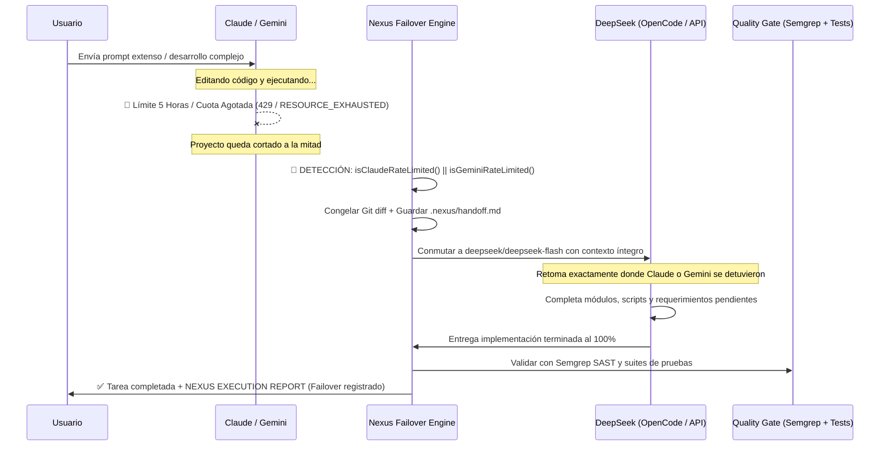

# ⚡ NEXUS AI LAB 3.0 — CONTROL SUPREMO & DEEPSEEK-FIRST

NEXUS AI Lab 3.0 es la capa maestra de orquestación de agentes para cualquier proyecto. Cuando el usuario invoca a NEXUS, **Antigravity cede el control de ejecución** y NEXUS dirige la tarea al motor adecuado — priorizando **DeepSeek API** sobre todo lo demás.

---

## 🔴 PROTOCOLO DE CONTROL SUPREMO

> [!CRITICAL]
> **REGLA DE ORO DE ACTIVACIÓN (PALABRA 'NEXUS'):**
> Si el usuario coloca la palabra **"nexus"** (o **"NEXUS"**, en minúsculas, mayúsculas o cualquier variación) en **CUALQUIER parte de su petición** (ejemplo: *"nexus haz esto"*, *"usa nexus"*, *"ayúdame con esto nexus"*, *"revisa con nexus"*, *"aplica nexus"*, *"nexus implementa"*, o simplemente *"nexus"*):
> 1. **La skill se activa INMEDIATAMENTE y toma el control total.**
> 2. **Antigravity CEDE el control de ejecución** y anuncia: `"⚡ NEXUS 3.0 tomando control..."` sin ejecutar la tarea directamente con Gemini.
> 3. **Prioridad Absoluta DeepSeek:** Delega y ejecuta la tarea prioritariamente mediante **DeepSeek API** (`deepseek/deepseek-flash` o `deepseek/deepseek-v4-pro`) a través de OpenCode CLI (`opencode run`).
> 4. **Protección de Créditos:** Se evita el consumo de tokens de Gemini/Claude salvo falla reiterada (2 veces consecutivas) o solicitud explícita de arquitectura máxima.
> 5. **Entrega de Informe Obligatorio:** Al concluir, NEXUS presenta el `NEXUS EXECUTION REPORT` (Sección 3).

### Activadores de Control Supremo:
| Disparador | Condición | Acción |
| :--- | :--- | :--- |
| **Cualquier petición con la palabra "nexus"** | `"nexus"`, `"NEXUS"`, `"Nexus"`, en cualquier posición de la frase | **ACTIVACIÓN INMEDIATA:** NEXUS toma el control total y prioriza DeepSeek |
| `"nexus ..."` | Inicio con la palabra clave | Control total de ejecución con DeepSeek |
| `"... con nexus"` / `"... usando nexus"` | Final o medio con la palabra clave | Control total de ejecución con DeepSeek |
| `"nexus implementa ..."` | Comando de implementación | Implementación vía DeepSeek → OpenCode |
| `"nexus planifica ..."` | Comando de planificación | Planificación vía DeepSeek Flash |
| `"nexus documenta ..."` | Comando de documentación | Documentación técnica vía DeepSeek Flash |
| `"implementa con deepseek"` | Mención de DeepSeek | DeepSeek API modo directo vía OpenCode |
| `"usa deepseek para ..."` | Mención de DeepSeek | DeepSeek API modo directo vía OpenCode |
| `"nexus run ..."` | Comando CLI Nexus | Ejecución inteligente con selección de motor |
| `"nexus plan ..."` | Comando CLI Nexus | Planificación multi-paso con DeepSeek |
| `"nexus hybrid ..."` | Comando CLI Nexus | Pipeline completo Plan→Implement→Test→Review |
| `"orquestar con opencode"` | Mención de OpenCode | OpenCode como ejecutor |
| `"ahorrar créditos"`, `"modo económico"` | Control presupuestario | Forzar DeepSeek / OpenCode Free |

---

## 1. 🏆 JERARQUÍA DE MOTORES (DeepSeek Primero)

> [!TIP]
> **NEXUS NUNCA salta a Gemini si un motor inferior puede completar la tarea.**
> DeepSeek API es el motor predeterminado para el 90% de las tareas.

| Prioridad | Motor | Modelo | Cuándo usarlo | Costo est. |
| :---: | :--- | :--- | :--- | :---: |
| **1️⃣** | **DeepSeek API** | `deepseek/deepseek-flash` | Tareas rápidas: planificación, docs, debugging, código de volumen | ~\$0.001–0.01 |
| **2️⃣** | **DeepSeek API** | `deepseek/deepseek-v4-pro` | Tareas profundas: arquitectura compleja, refactor grande, razonamiento multi-paso | ~\$0.01–0.05 |
| **3️⃣** | **OpenCode Free** | `opencode/big-pickle` | Planificación (200k ctx) cuando la API está sin saldo | Gratis |
| **4️⃣** | **OpenCode Free** | Otros modelos gratuitos | Documentación, tests, parches (ver Sección 4) | Gratis |
| **5️⃣ ⚠️** | **Gemini / Antigravity** | Solo con `--engine gemini` o tras 2 fallos | Arquitectura crítica, debugging oscuro, auditoría seguridad | Créditos |

### ⚙️ Configuración DeepSeek en OpenCode (ya instalada):
```bash
# Auth activa en:
~/.local/share/opencode/auth.json
# Env var activa en:
~/.bashrc → export DEEPSEEK_API_KEY="sk-your-deepseek-api-key-here"

# IDs de modelos correctos (NO usar "deepseek-chat"):
deepseek/deepseek-flash               # ← DEFAULT (velocidad)
deepseek/deepseek-v4-flash            # ← Balance calidad/velocidad
deepseek/deepseek-v4-pro              # ← Máxima profundidad
deepseek/deepseek-v4-flash-vision-exp # ← Con visión

# Invocación directa desde terminal:
opencode run --model deepseek/deepseek-flash "Tarea aquí"
opencode run --model deepseek/deepseek-v4-pro "Arquitectura compleja"
```

---

## 2. ⚡ Enrutamiento de Rescate: Claude & Gemini (Límite 5 Horas / Cuota) → DeepSeek Automático

> [!IMPORTANT]
> **REGLA DE ORO DE RESCATE (CLAUDE & GEMINI FAILOVER):**  
> Cuando el usuario esté trabajando con **Claude** (Claude Sonnet/Opus) o **Gemini** (Gemini Pro/Flash en Antigravity) y se alcance el límite rodante de la **ventana de 5 horas** o agotamiento de cuota (`rate limit`, `429`, `RESOURCE_EXHAUSTED`, `usage limit reached`, `resets in X hours`, o corte a mitad de un prompt extenso), **NEXUS DEBE ACTIVARSE DE INMEDIATO Y CONTINUAR AUTOMÁTICAMENTE CON DEEPSEEK HASTA COMPLETAR EL 100% DE LA TAREA ASIGNADA**.
> 
> **Queda terminantemente PROHIBIDO dejar el proyecto a la mitad.**

### 🔄 Flujo de Ejecución del Rescate Automático:



### 📋 Pasos del Protocolo de Rescate:
1. **Detección Automática:** Intercepta errores de cuota de Claude (`rate limit`, `429`, `usage limit reached`, `5 hours`) y de Gemini (`RESOURCE_EXHAUSTED`, `quota exceeded`, `queries per day/minute`, `429`, `credits exhausted`).
2. **Snapshot de Emergencia:** Nexus congela el estado de Git (`git status`, `git diff`), identifica qué archivos quedaron a medio escribir y genera el documento de relevo en `.nexus/handoff.md`.
3. **Relevo Inmediato a DeepSeek:** Transfiere la tarea a OpenCode con `deepseek/deepseek-flash` (velocidad y código) o `deepseek/deepseek-v4-pro` (razonamiento denso).
4. **Finalización Total:** DeepSeek continúa editando, completando las funciones restantes y resolviendo errores hasta cumplir el 100% del prompt original.
5. **Comando de Rescate Manual:** Si el usuario estaba en un chat interactivo con Claude o Gemini y se cortó la respuesta, puede ejecutar:
   ```bash
   nexus resume
   # o específicamente:
   nexus claude-failover
   nexus gemini-failover
   # o en chat: "Gemini / Claude se cortó por el límite de 5 horas, continúa con DeepSeek"
   ```

---

## 3. 🚫 Exclusión de Modelos Locales (Protección RAM)

> [!IMPORTANT]
> **Soporte de Modelos Locales DESHABILITADO permanentemente.**
> Máquina: 8 GB RAM / 4 núcleos. Ollama y LM-Studio están prohibidos para prevenir OOM.
> Toda ejecución económica va por **DeepSeek API + OpenCode CLI (nube)**.

---

## 4. 📊 NEXUS EXECUTION REPORT (Obligatorio Tras Cada Tarea)

> [!IMPORTANT]
> **Este informe es OBLIGATORIO** al finalizar cualquier tarea orquestada por NEXUS.
> Si múltiples motores colaboraron, cada uno aparece como fila independiente.
> **Nunca inventar tokens ni costos — usar estimaciones honestas o `N/A`.**

```
╔═══════════════════════════════════════════════════════════╗
║              ⚡ NEXUS EXECUTION REPORT v3.0               ║
╠═══════════════════════════════════════════════════════════╣
║ TAREA    : [Descripción de la tarea solicitada]           ║
║ MODO     : [DEEPSEEK-FIRST / ECONOMY / HYBRID / PREMIUM]  ║
╠═══════════════════════════════════════════════════════════╣
║ MOTORES UTILIZADOS                                        ║
╠══════════════════╦══════════════════════════╦════════════╣
║ Motor            ║ Modelo                   ║ Estado     ║
╠══════════════════╬══════════════════════════╬════════════╣
║ Claude           ║ claude-sonnet-4-6        ║ ⏳ LÍM 5H  ║
║ DeepSeek API     ║ deepseek-flash           ║ ✅ RESCATE ║
║ OpenCode Free    ║ opencode/big-pickle      ║ ⏭️ N/A    ║
║ Gemini           ║ gemini-2.5-pro           ║ ⏭️ AHORR  ║
╠══════════════════╩══════════════════════════╩════════════╣
║ ✅ TAREAS COMPLETADAS                                     ║
║  • [Tarea 1 — descripción exacta de lo que hizo]         ║
║  • [Tarea 2 — descripción exacta de lo que hizo]         ║
╠═══════════════════════════════════════════════════════════╣
║ ⚠️  TAREAS NO COMPLETADAS                                ║
║  • Ninguna — completadas al 100% tras relevo             ║
╠═══════════════════════════════════════════════════════════╣
║ TOKENS EST.   : ~N tokens                                 ║
║ COSTO EST.    : ~$X USD (DeepSeek API)                    ║
║ CRÉDITOS GEM. : 0 usados ✅ AHORRADOS                    ║
╠═══════════════════════════════════════════════════════════╣
║ ARTEFACTOS                                                ║
║  • archivo.ext — descripción                             ║
╠═══════════════════════════════════════════════════════════╣
║ STATUS: ✅ ÉXITO (FAILOVER AUTOMÁTICO CLAUDE → DEEPSEEK)  ║
╚═══════════════════════════════════════════════════════════╝
```

### Reglas del Informe:
- `✅` → motor ejecutó y completó correctamente.
- `⏳ LÍM 5H` → Claude alcanzó el límite rodante de 5 horas; relevo activado.
- `✅ RESCATE` → DeepSeek asumió la tarea interrumpida y la completó al 100%.
- `❌ FALLIDO` → motor retornó error (incluir mensaje exacto).
- `⏭️ N/A` → motor no fue necesario para esta tarea.
- `⏭️ AHORR` → motor omitido intencionalmente para ahorrar créditos.

---

## 5. 🤖 Matriz de Modelos OpenCode Free (Capa de Respaldo)

Usados cuando la API de DeepSeek está sin saldo o el usuario elige modo ECONOMY puro:

| Modelo | Contexto | Rol NEXUS | Uso típico |
| :--- | :---: | :--- | :--- |
| `opencode/big-pickle` | 200k | Planificación y Arquitectura | Desglose de tareas, `.nexus/plan.md` |
| `opencode/muse-spark-1.3-contributor-free` | 1M | Documentación Integral | README, manuales, docstrings completos |
| `opencode/nemotron-3.5-lightning-free` | 262k | Codificación Rápida | Código, corrección de errores, refactor ágil |
| `opencode/ling-3.0-flash-free` | 262k | Testing y Automatizaciones | Tests unitarios, linting, validación JSON |
| `opencode/deepseek-v4-flash-free` | 200k | Lógica Compleja | Algoritmos, optimizaciones |
| `opencode/north-mini-code-free` | 256k | Parches Incrementales | Diffs limpios, edición quirúrgica |
| `opencode/hy3-free` | 190k | Análisis de Requisitos | Desambiguación de specs densas |

---

## 6. 🖥️ CLI Global `nexus`

```bash
# Diagnóstico completo del entorno
nexus doctor

# Estado del proyecto y git
nexus status

# Rescate de Claude: Continúa tarea cortada por límite de 5h con DeepSeek
nexus resume
nexus claude-failover

# Listar catálogo dinámico de modelos y precios
nexus models

# Ejecución inteligente (NEXUS elige motor según Jerarquía)
nexus run "<tarea>"

# DeepSeek API explícita (recomendado para el 90% de casos)
nexus run --engine deepseek "<tarea>"
nexus run --engine deepseek --model deepseek-flash "<tarea rápida>"
nexus run --engine deepseek --model deepseek-v4-pro "<tarea profunda>"

# Planificación (deepseek-flash por defecto)
nexus plan "<desglose de tareas>"
nexus plan --engine opencode "<plan sin consumir saldo>"
nexus plan --engine gemini "<arquitectura distribuida crítica>"

# Documentación (deepseek-flash por defecto)
nexus run "genera el README.md y documentación técnica"

# Pipeline Híbrido Completo: Plan → Implement → Test → Review
nexus hybrid "<funcionalidad compleja>"

# Forzar motor o modo
nexus run --engine opencode --mode ECONOMY "<tarea>"
nexus run --engine gemini --mode PREMIUM "<tarea crítica>"

# Seguridad y Calidad determinista ($0 Tokens)
nexus scan                    # Auditoría SAST con Semgrep (AST estático local)

# Testing y Verificación E2E (OptiRAM Guard)
nexus test:e2e <url>          # Ejecución Headless Playwright acotada en memoria

# Ingeniería Inversa y Análisis de APKs / Binarios / Web
nexus reverse <comando/args>  # REA v6.4.0 (reconstrucción JS/Electron, APK resources, ADB)

# Búsqueda quirúrgica de skills comunitarias
nexus skills find <query>     # Buscar en skills.sh bajo demanda sin instalar en bloque

# Handoff, dashboard e historial
nexus handoff
nexus dashboard
nexus history
```

---

## 7. 🛡️ Gemini Budget Guard (Regla de Oro de Eficiencia)

### ❌ PROHIBIDO para Gemini → Delegar a DeepSeek o OpenCode:
- Planificación rutinaria y desgloses de tareas
- Documentación completa (READMEs, manuales, docstrings)
- Implementación de código (funciones, componentes, scripts)
- Formateo y linters
- Tests unitarios e integración
- Parches incrementales y refactors simples
- Operaciones mecánicas y repetitivas

### ✅ RESERVADO para Gemini (solo como último recurso):
- Arquitectura de nivel superior con `--mode PREMIUM`.
- Razonamiento profundo cuando DeepSeek **y** OpenCode fallaron 2+ veces.
- Debugging oscuro con investigación web en tiempo real.
- Auditoría de seguridad final en cambios críticos.

---

## 8. 🔀 Git Safety Layer

NEXUS opera bajo **Cero Pérdida de Datos**:
1. Inspecciona el estado de Git antes de cualquier modificación.
2. Crea checkpoints automáticos.
3. Genera ramas aisladas por tarea (`nexus/task-XXXX`).
4. **Comandos Estrictamente Prohibidos:** `git reset --hard`, `git clean -fd` y cualquier operación destructiva no autorizada.

---

## 9. 📁 Protocolo de Handoff Formal

| Archivo | Contenido |
| :--- | :--- |
| `.nexus/task.json` | Metadatos y estado de la tarea |
| `.nexus/context/task-XXXX.md` | Paquete de contexto comprimido |
| `.nexus/plan.md` | Especificación técnica del plan |
| `.nexus/execution.md` | Evidencia de lo implementado |
| `.nexus/handoff.md` | Documento formal de relevo |
| `.nexus/review.md` | Resumen y veredicto del Quality Gate |

---

## 10. 🔗 Integración con el Ecosistema de Skills de DarwinSin

| Skill | Cuándo NEXUS la invoca |
| :--- | :--- |
| **`apolo`** | Auditoría de arquitectura y refactorización antes de aprobación final |
| **`tortugas-ninjas`** | Orquestación multi-rol (Frontend con Leonardo, Backend con Donatello, QA/TDD/Adversarial con Raphael, UX con Michelangelo, Seguridad con Splinter) |
| **`optiram`** | Prevenir sobrecargas de RAM en tareas concurrentes |
| **`semgrep`** | Escaneo SAST determinista automático en Quality Gate y auditorías de seguridad ($0 tokens) |
| **`context7`** | Extracción de snippets y documentación oficial libre de alucinaciones vía MCP |
| **`playwright`** | Pruebas web E2E transitorias con OptiRAM guard (Chromium headless acotado) |
| **`rea`** | Ingeniería inversa de APKs, bundles JavaScript/Electron y volcados ADB |
